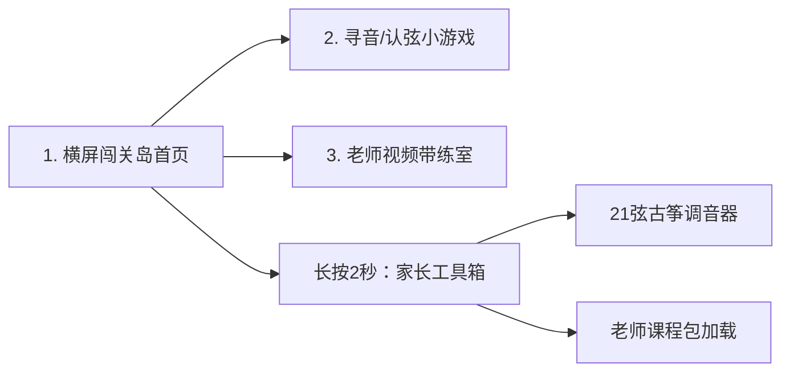

# 5岁儿童古筝启蒙游戏化 App — MVP 设计与实现方案

- **日期**：2026-11-18
- **目标用户**：5 岁零基础启蒙女童（不识字、注意力集中时间 5~10 分钟、需要高频正向反馈）
- **使用场景**：Android 手机（主力）及 iOS 手机，**横屏固定在古筝谱架上**，边看边在真古筝上拨弦练习
- **定弦基准**：标准 21 弦 D 调五声音阶定弦（第 3、8、13、18 弦为绿色标志弦 `5 / Sol`）
- **核心约束**：安装包极小（Android Release APK 目标 **< 5 MB**），拒绝臃肿引擎与内置大体积静态媒体

---

## 一、 核心设计原则

1. **零文字交互（全语音 + 色彩/动物视觉锚点）**
   - 5 岁儿童无法阅读文字说明，界面所有引导均通过**亲切语音播报** + **超大卡通图标（热区 ≥ 64×64px）**完成。
   - 五声音阶映射为固定颜色与小动物形象（结合唱名/数字发音记忆）：
     - `1 (Do / D)`：红色 · **朵朵兔** 🐰（耳**朵** `duǒ` ≈ **Do**）
     - `2 (Re / E)`：橙色 · **小天鹅** 🦢（**鹅** `é` ≈ **二**，长脖子像数字 `2`）
     - `3 (Mi / F#)`：黄色 · **小猫咪** 🐱（猫**咪** `mī` = **Mi**）
     - `5 (Sol / A)`：**绿色（对应古筝绿弦）· 小蛇** 🐍（**蛇** `shé` ≈ **Sol**，核心锚点！）
     - `6 (La / B)`：蓝紫色 · **小考拉** 🐨（考**拉** `lā` = **La**）
   - 基础启蒙指法图标化：
     - **托（大指向外拨）**：大拇指小火箭图标 + 口诀“大指托一托”
     - **抹（食指向内拨）**：食指小弯钩图标 + 口诀“食指抹一抹”
     - **勾（中指向内拨）**：中指小山峰图标 + 口诀“中指勾一勾”
2. **微关卡设计（1~2 分钟一局）**
   - 每关只聚焦 1 个小目标（通常 4~8 个音），弹对即触发粒子烟花与鼓励音效，累计星星收集贴纸。
3. **内置“家长调音器”（防误判前提）**
   - 儿童通过麦克风在真古筝上跟练时，如果家里的古筝本身跑音，会导致孩子弹对了弦却被判错而产生挫败感。
   - 因此 MVP 必须包含一个**家长极速调音器**（长按右上角家长锁 2 秒进入），方便爸爸在练习前 1 分钟检查 21 根弦的音准。

---

## 二、 轻量化双端技术架构与体积预算

### 2.1 技术栈选型（方案 A）

| 层级 | 选型 | 体积开销 (Gzipped) | 选型理由 |
|---|---|---|---|
| **跨端容器** | **Capacitor 8** (`@capacitor/core` + `@capacitor/android` + `@capacitor/ios`) | ~300 KB (原生壳) | 直接复用系统自带 Android System WebView / iOS WKWebView，不打包几十兆的浏览器或渲染引擎 |
| **前端框架** | **Vite + Preact + TypeScript** | ~4 KB | 兼容 React 组件开发体验，运行时仅 3KB，启动极快 |
| **样式与布局** | **Tailwind CSS** (按需 Purge) | ~8 KB | 快速构建响应式横屏手机界面 |
| **实时听音算法** | **Web Audio API + `pitchy` (MPM 算法)** | ~3 KB | 纯数学时域基频检测（McLeod Pitch Method），0 深度学习模型体积，古筝单音拨弦识别延迟 < 30ms |
| **游戏动画** | **原生 SVG + CSS 硬件加速 + 轻量 Canvas 粒子** | ~5 KB | 矢量绘本图形清晰度高，无需引入 Cocos/Pixi 等数兆级引擎 |
| **数据存储** | **IndexedDB / localStorage** | 0 KB | 本地持久化闯关进度、贴纸册与下载的老师课程包缓存 |

- **APK 体积控制策略**：
  1. Android 构建配置 `ndk { abiFilters "arm64-v8a" }`（仅保留 64 位 ARM 架构）+ 开启 `isMinifyEnabled = true` 和 `isShrinkResources = true`。
  2. **媒体资源外置**：老师录制的示范视频（`.mp4`）和自定义语音包通过局域网/云端 URL 按需下载并缓存在手机本地目录，APK 内仅内置 1 个基于矢量动画的体验关卡和合成音效（Web Audio 合成古筝泛音/星星奖励音）。
  3. 最终 Android Release APK 预计体积：**2.5 MB ~ 4.5 MB**。

---

## 三、 21 弦 D 调定弦频率基准表與识别策略

古筝标准 21 弦 D 调（1 = D）从距离身体最近的高音 1 弦到最远的低音 21 弦频率如下（启蒙阶段 90% 练习集中在 **中音区 8~13 弦** 及 **绿弦 3/8/13/18 弦**）：

| 弦号 | 颜色 | 简谱音名 (D调) | 国际音名 | 标准频率 (Hz) | 启蒙权重 |
|---|---|---|---|---|---|
| 1 弦 | 白 | 倍高音 `1` | D6 | 1174.66 | 低 |
| 2 弦 | 白 | 高音 `6` | B5 | 987.77 | 低 |
| **3 弦** | **绿** | **高音 `5`** | **A5** | **880.00** | **高（认绿弦）** |
| 4 弦 | 白 | 高音 `3` | F#5 | 739.99 | 中 |
| 5 弦 | 白 | 高音 `2` | E5 | 659.25 | 中 |
| 6 弦 | 白 | 高音 `1` | D5 | 587.33 | 高 |
| 7 弦 | 白 | 中音 `6` | B4 | 493.88 | **核心（中音区）** |
| **8 弦** | **绿** | **中音 `5`** | **A4** | **440.00** | **核心（绿弦 + 中音区）** |
| 9 弦 | 白 | 中音 `3` | F#4 | 369.99 | **核心（中音区）** |
| 10 弦 | 白 | 中音 `2` | E4 | 329.63 | **核心（中音区）** |
| 11 弦 | 白 | 中音 `1` | D4 | 293.66 | **核心（中音区）** |
| 12 弦 | 白 | 低音 `6` | B3 | 246.94 | 高（常用伴奏/八度） |
| **13 弦** | **绿** | **低音 `5`** | **A3** | **220.00** | **核心（绿弦 + 大撮基准）** |
| 14 弦 | 白 | 低音 `3` | F#3 | 185.00 | 中 |
| 15 弦 | 白 | 低音 `2` | E3 | 164.81 | 中 |
| 16 弦 | 白 | 低音 `1` | D3 | 146.83 | 中 |
| 17 弦 | 白 | 倍低音 `6` | B2 | 123.47 | 低 |
| **18 弦** | **绿** | **倍低音 `5`** | **A2** | **110.00** | **高（认绿弦）** |
| 19 弦 | 白 | 倍低音 `3` | F#2 | 92.50 | 低 |
| 20 弦 | 白 | 倍低音 `2` | E2 | 82.41 | 低 |
| 21 弦 | 白 | 倍低音 `1` | D2 | 73.42 | 低 |

### 针对 5 岁儿童的听音判分容错设计
1. **音分容差（Cents Tolerance）**：
   - 计算公式：$\text{cents} = 1200 \times \log_2\left(\frac{f_{\text{detected}}}{f_{\text{target}}}\right)$
   - **儿童闯关模式**：放宽至 **±40 cents**（由于五声音阶相邻弦至少相差大二度 200 cents 或小三度 300 cents，±40 cents 绝对不会串弦误判，同时能容忍家里古筝轻微跑音或小孩用力过猛导致的弦张力瞬态偏高）。
   - **家长调音模式**：严格控制在 **±8 cents** 以内显示绿灯。
2. **防误触与谐波过滤**：
   - 置信度阈值（Clarity Threshold）：`pitchy` clarity ≥ `0.82`，且 RMS 音量过门限（过滤大人说话声与环境底噪）。
   - 八度泛音防抖：古筝拨弦瞬间偶发二次谐波（高八度），若检测到目标弦恰好高八度的频率且能量快速衰减，可结合前序帧平滑归并。
   - 连续稳定帧确认：连续 **3 帧（约 90ms）** 命中目标弦号即判定成功，立即触发视觉/音效反馈，无需等余音结束。

---

## 四、 横屏手机 UI 与功能模块设计

由于手机横屏放置在谱架上（典型视口比例 `16:9` 或 `20:9`，高度较窄、宽度充裕），所有页面均采用**左右分栏**或**横向流式**布局，禁止出现需要纵向滚动的复杂页面。



### 模块 1：横屏闯关岛首页（Map Screen）
- **主视觉**：横向滑动的卡通小岛关卡（1~5 关内置启蒙主线 + 老师扩展关卡）。
- **顶部栏**：左侧“我的贴纸本”（展示已获得的动物贴纸與星星总数）；右侧半透明小锁图标（**长按 2 秒**进入家长调音器与课程包管理，防小孩误点）。

### 模块 2：寻音与认弦小游戏（Game Screen）
- **布局**：
  - **上方 35%**：卡通引导角色（如绿色小蛇、小猫咪、小考拉）+ 当前目标气泡（显示动物 + 弦号颜色 + 指法大图标，点击可重听语音提示）。
  - **下方 65%**：**交互式古筝面板**（支持“全局 21 弦视图”找绿弦，或放大“中音区 6~13 弦特写视图”方便看清）。
- **内置启蒙关卡序列**：
  1. **《寻找绿弦小蛇》**：依次点亮第 8 弦、第 13 弦、第 3 弦、第 18 弦四根绿弦，引导孩子在真古筝上找到对应的绿色琴弦（小蛇弦）拨响。
  2. **《大指托一托：唤醒小蛇》**：锁定第 8 弦（中音 5，绿弦），配合“大指托”手势动画，慢速连弹 4 下。
  3. **《小猫咪与小考拉：勾托抹托》**：结合第 9 弦（中音 3 · 小猫咪）、第 8 弦（中音 5 · 小蛇）、第 7 弦（中音 6 · 小考拉）及第 13 弦（低音 5 · 小蛇）做基础指法交替练习。
  4. **《五音动物园》**：中音区 11 弦(`1`·朵朵兔)、10 弦(`2`·小天鹅)、9 弦(`3`·小猫咪)、8 弦(`5`·小蛇)、7 弦(`6`·小考拉) 顺阶寻宝。

### 模块 3：老师视频带练室（Teacher Practice Screen）
专为横屏手机窄高度优化的 **左右黄金分屏**：
- **左半屏（52% 宽度）：老师示范视频播放器**
  - 大按钮控制栏（无文字纯图标）：
    - 🐢 **慢速按钮**：一键在 `0.6x`（慢速学指法）与 `1.0x`（原速）之间切换，保持原音高不变调。
    - 🔁 **AB 循环按钮**：循环播放当前正在练习的小分句。
    - 🪞 **镜像翻转按钮**：适应不同架机角度。
- **右半屏（48% 宽度）：分段跟弹闯关区**
  - **交互流程（先看后弹 / 边看边弹双模式）**：
    1. **示范阶段**：左侧播放老师第 1 小句示范（如 5 秒），右侧同步高亮老师正在弹的弦号与指法图标。
    2. **跟弹阶段**：老师视频自动暂停在示范结束帧，语音提示“轮到宝贝啦！”，右侧依次高亮本句的 4 个目标音（弦号 + 动物 + 指法），麦克风实时监听，孩子每弹对一个音就点亮一颗星，4 个音全对后自动解锁并播放老师的下一小句！

### 模块 4：家长工具箱（调音器 + 课程包导入）
- **21 弦古筝专用调音器**：自动识别当前拨响的是第几弦，仪表盘指针显示偏低/偏高/准确（绿灯），帮家长快速调准 D 调 21 弦。
- **课程包导入**：支持选择手机本地目录中的视频与 JSON 配置文件，或输入局域网/云端地址加载老师新录制的课程。

---

## 五、 老师配合的《课程包数据规范》（Course Pack Schema）

为了让老师录制最省心、爸爸配置最高效，每节带练课只需 **1 个短视频文件（MP4）** + **1 个 `lesson.json` 描述文件**：

```json
{
  "id": "lesson-twinkle-01",
  "title": "小星星（第一句）",
  "tuning": "D",
  "videoUrl": "./twinkle-part1.mp4",
  "segments": [
    {
      "id": "seg-1",
      "videoStartSec": 0.0,
      "videoEndSec": 6.5,
      "promptVoiceText": "先看老师弹一遍：一闪一闪亮晶晶，注意大指托和食指抹哦！",
      "steps": [
        { "stringNum": 11, "jianpu": "1", "finger": "tuo", "label": "托 11弦" },
        { "stringNum": 11, "jianpu": "1", "finger": "mo",  "label": "抹 11弦" },
        { "stringNum": 8,  "jianpu": "5", "finger": "tuo", "label": "托 8弦(绿)" },
        { "stringNum": 8,  "jianpu": "5", "finger": "mo",  "label": "抹 8弦(绿)" }
      ]
    },
    {
      "id": "seg-2",
      "videoStartSec": 6.5,
      "videoEndSec": 13.0,
      "promptVoiceText": "太棒啦！接着看下一句：满天都是小星星！",
      "steps": [
        { "stringNum": 7,  "jianpu": "6", "finger": "tuo", "label": "托 7弦" },
        { "stringNum": 7,  "jianpu": "6", "finger": "mo",  "label": "抹 7弦" },
        { "stringNum": 8,  "jianpu": "5", "finger": "gou", "label": "勾 8弦(绿)" }
      ]
    }
  ]
}
```
> **注**：后续还可以在家长工具箱里内置一个“60秒打点小工具”——爸爸看着老师发来的微信视频，边播边点几下屏幕上的弦号，直接导出上述 JSON。

---

## 六、 分步开发与验证计划（TDD 驱动）

我们将项目创建在 `/Users/chenxiaozheng/workspace/code/guzheng-buddy`，按以下 5 个可独立验证的步骤推进：

### Step 1：核心古筝定弦与听音引擎（纯逻辑层 + 单元测试）
- 实现 21 弦 D 调频率字典、音分偏差计算、最近弦匹配与抗抖动状态机（连续帧确认 + 谐波过滤）。
- 实现课程包 JSON Schema 校验（Zod）与分段跟练状态机。
- **验证要求**：使用 Vitest 编写完整的单元测试（覆盖 21 弦标准频率、±40 cents 边界、环境噪音过滤、连续帧防抖、课程包解析），测试覆盖率 ≥ 80%。

### Step 2：音频合成器与麦克风监听适配层
- 基于 Web Audio API 实现：
  1. **零体积古筝拨弦合成器（Karplus-Strong / 泛音包络合成）**：当孩子点击屏幕上的虚拟琴弦或还没坐在真古筝前时，也能发出逼真的古筝标准音高供试听和模拟测试。
  2. **欢乐奖励音效合成器**：闯关星星音、小猫咪/欢呼音效、过关和弦音，全部用 Web Audio 实时合成，0 音频文件体积。
  3. **实时麦克风监听流**：接入 `pitchy` MPM 检测器，提供同时支持“真琴麦克风输入”与“开发调试模拟拨弦”的双通道接口。

### Step 3：横屏绘本风 UI 与【寻音/认弦小游戏】
- 搭建横屏响应式主框架、闯关地图、贴纸收集册。
- 实现交互式古筝琴弦组件（白弦/绿弦高亮、手指拨动波浪动画、动物与指法气泡、Web Speech 语音引导）。
- 跑通前 4 个内置启蒙小游戏关卡。

### Step 4：【老师视频带练室】与【家长工具箱（21弦调音器 + 快速打点器）】
- 实现左视频（0.6x 慢速、AB 循环、镜像翻转）+ 右跟弹闯关组件。
- 内置 1 节完整的演示带练课（支持上传/选择手机里的老师 MP4 视频并直接在应用内打点配置目标琴弦）。
- 实现家长 21 弦高精度调音器。

### Step 5：Capacitor Android 工程封装与极小体积裁剪
- 集成 Capacitor Android 平台，配置横屏锁定（`sensorLandscape`）、麦克风权限声明。
- 配置 Gradle 单 `arm64-v8a` ABI 过滤与 R8 代码/资源压缩，验证生产构建产物体积。

---

## 七、 风险与 Phase 2 演进预留

- **环境噪音干扰风险**：通过动态底噪门限（RMS Gate）+ `pitchy` 清晰度阈值（Clarity ≥ 0.82）过滤说话声。
- **Phase 2 摄像头手型辅助接口预留**：在 `TeacherPracticeScreen` 右上角预留摄像头画中画（PiP）挂载点，Phase 2 可按需动态加载 `@mediapipe/tasks-vision` 手部关键点模型，在不增加基础安装包体积的前提下实现手腕塌陷与手型提醒。
